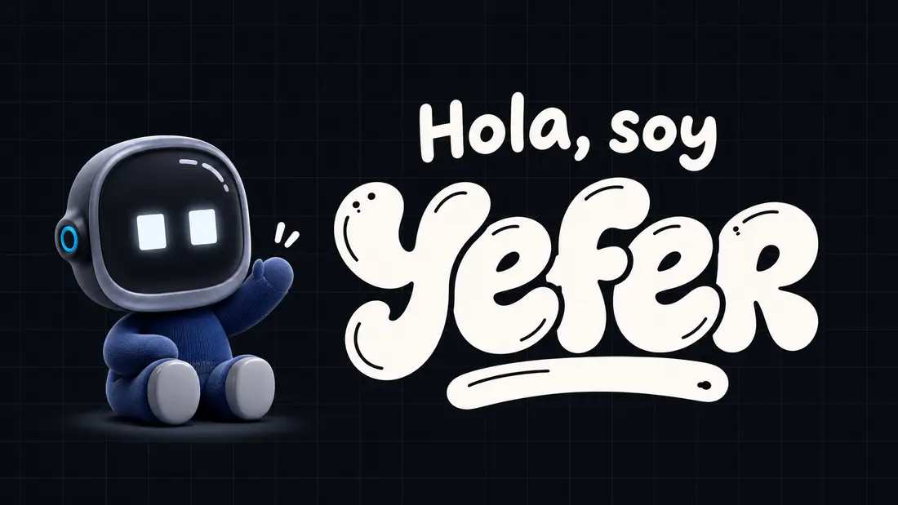

  

  

### Un poco sobre mí

Soy **Yeferson Najar**, estudiante de Análisis y Desarrollo de Software en el **SENA**. Me interesa crear sitios web y aplicaciones que sean útiles, intuitivas y estén bien diseñadas. Disfruto aprender nuevas tecnologías y mejorar cada proyecto que hago.

- 📍 Yopal, Casanare, Colombia
- 💻 Desarrollo web y de aplicaciones
- 🎯 Mi objetivo: seguir aprendiendo y construir proyectos cada vez mejores

### Tecnologías con las que trabajo y aprendo

  

### Proyectos

| Proyecto | ¿De qué trata? |
| --- | --- |
| **Sava** | Aplicación para apoyar a pequeños negocios de Casanare con sus ventas y organización. |
| **AsistIA** | Sistema de asistencia automatizada con reconocimiento facial y notificaciones. |
| **XchanGo** | Plataforma para intercambiar artículos mediante trueques. |

### Mi actividad en GitHub

  
  

### Mis contribuciones

<picture>
  <source media="(prefers-color-scheme: dark)" srcset="https://raw.githubusercontent.com/Yeferstx/Yeferstx/output/github-contribution-grid-snake-dark.svg" />
  <source media="(prefers-color-scheme: light)" srcset="https://raw.githubusercontent.com/Yeferstx/Yeferstx/output/github-contribution-grid-snake.svg" />
  
</picture>

---

  <a href="https://yeferstack.github.io">Mi portafolio web</a> · <a href="https://github.com/Yeferstx?tab=repositories">Mis repositorios</a>

