

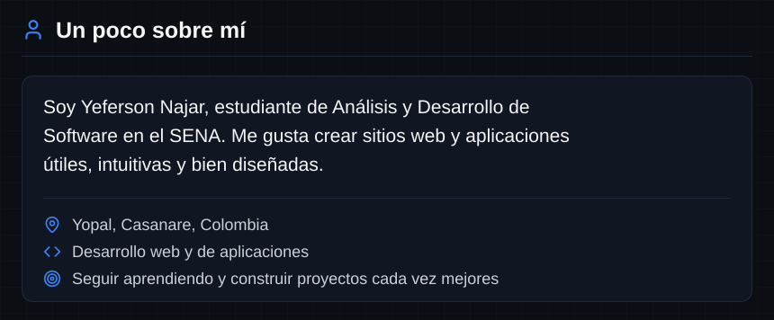
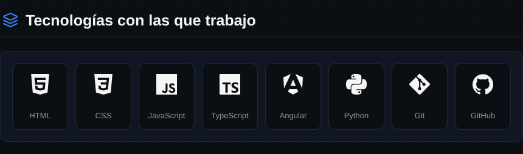
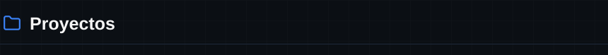
<a href="https://github.com/Yeferstx/Sava">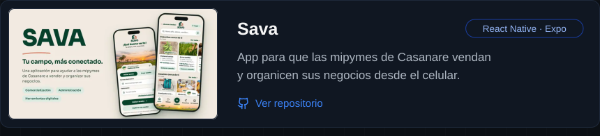</a>
<a href="https://github.com/Yeferstx/AsisTIA-ADSO">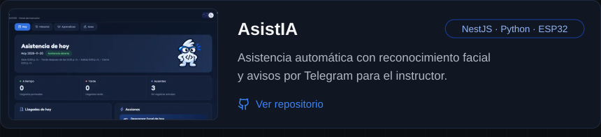</a>
<a href="https://github.com/Yeferstx/Xchango_APIS_DJANGO">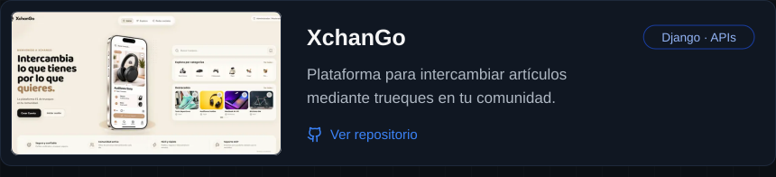</a>
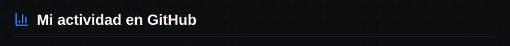

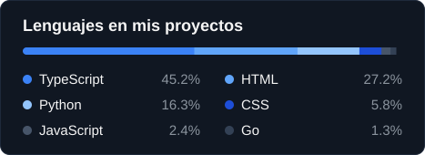


<a href="https://github.com/Yeferstx?tab=repositories">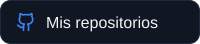</a>

